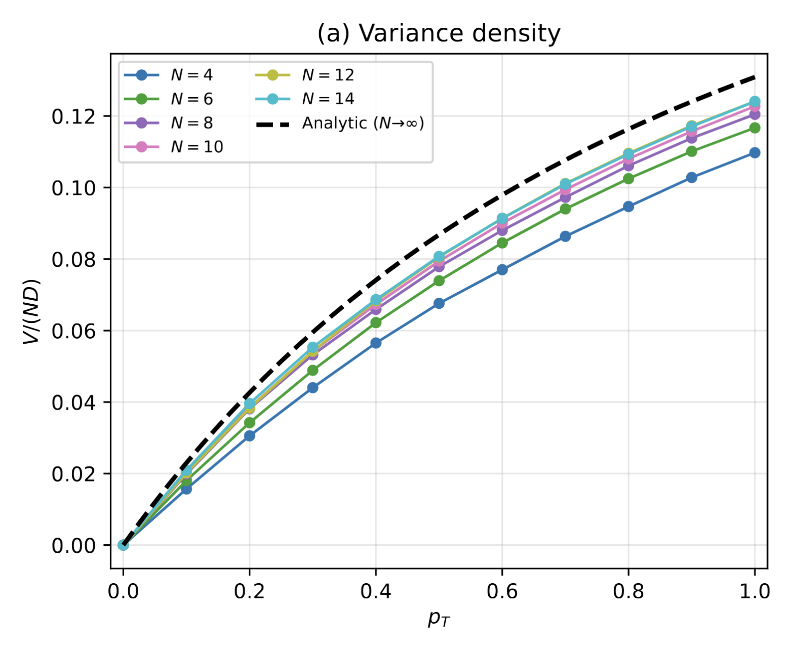

# ⚛️ Pauli-Path Weight Variance in Clifford+T Circuits

**Heisenberg-picture operator spreading simulations using [PauliPropagation.jl](https://github.com/SparqleSim/PauliPropagation.jl).**

This project studies how **non-Clifford quantum resources**, controlled by the density of T gates, affect the spreading of Pauli operators in random quantum circuits. We use a custom moment-propagation implementation built on `PauliPropagation.jl` to efficiently calculate statistical fluctuations in operator spreading.

---

## 🧠 Motivation: What Is Pauli-Path Weight Variance?

As a Pauli operator evolves through a quantum circuit, it can spread to more qubits. Under **Clifford gates**, a Pauli string is mapped to another Pauli string. **T gates** can cause it to branch into multiple contributions, producing different **Pauli paths** through the circuit.

The **weight** of a Pauli string is simply the number of qubits on which it acts nontrivially. For each Pauli path, we add this weight across successive circuit layers to obtain its **total accumulated weight**. Different paths can accumulate different weights; the **variance of the total accumulated weight** measures how much these paths differ in their spreading histories. Our calculations use the corresponding squared path amplitudes as statistical weights.

Our central question is whether operator spreading in **non-Clifford circuits** can be quantitatively related to **T-gate density**, a simple measure of the non-Clifford resources introduced into the circuit. We find that the averaged path-weight variance **increases monotonically with T-gate insertion probability** in the studied circuit ensemble. This provides a useful numerical direction for exploring connections among operator dynamics, quantum magic, and quantum resource estimation.

## ⚙️ Numerical Method

We simulate **one-dimensional random Clifford+T brickwork circuits** with open boundaries using [`PauliPropagation.jl`](https://github.com/SparqleSim/PauliPropagation.jl). Each layer contains random two-qubit Clifford gates followed by single-qubit T gates inserted independently with probability `pT` at eligible sites.

Rather than explicitly storing every complete Pauli path, the implementation **propagates compact statistical moments** through a sparse Pauli representation:

- **Heisenberg-picture propagation:** reuse `PauliPropagation.jl`'s Clifford operations, T-gate branching, and sparse Pauli storage.
- **Accumulated-weight tracking:** update the running weight statistics after each complete Clifford+T layer.
- **Deterministic variance calculation:** obtain the path-weight variance from propagated moments, without explicitly enumerating the full history of every path or using numerical derivatives.
- **Ensemble averaging:** sample random initial Pauli strings and circuits, calculate variance for each realization, and average over realizations.

Two sparse backends are supported: `PauliSum` (`BACKEND=dict`, default) and `VectorPauliSum` (`BACKEND=vector`). Propagation uses `Float64` moment coefficients and no user-selected coefficient truncation. The number of stored Pauli strings can still grow substantially as T-gate branching increases.

### Performance and reproducibility

The code is designed for numerical research on local machines or HPC clusters:

- Parallelize independent realizations using Julia threads.
- Reuse each sampled Clifford circuit and T-gate random-number table across the `pT` scan.
- Use deterministic, nonoverlapping realization seeds across independent jobs.
- Save intermediate depth checkpoints and resume interrupted jobs.
- Record normalization diagnostics, per-realization data, summary statistics, and run metadata.

## 📊 Numerical Results: Four-Layer Circuits



*Ensemble-averaged path-weight variance density `V/(ND)` versus T-gate insertion probability `pT`, for circuit depth `D=4` and `N=4, 6, 8, 10, 12, 14` qubits. The colored markers are numerical simulations.*

The numerical curves show that **variance density increases monotonically with `pT`**. As system size grows, the curves move closer together, suggesting relatively modest finite-size effects for the larger simulated systems.

Here `V` is the ensemble average of the variance calculated **within each circuit realization**; the density divides by the number of qubits `N` and circuit depth `D`.

## 🛠️ Installation and Usage

**Requirements:** Julia 1.10+ and the packages in `Project.toml` (`PauliPropagation.jl`, `CSV.jl`, and `DataFrames.jl`).

From the repository root:

```bash
julia --project=. -e 'using Pkg; Pkg.instantiate()'
```

Run a small four-layer example:

```bash
mkdir -p results
L=8 CHECKPOINT_LAYERS=4 NS=100 JOB_INDEX=1 \
  INITIAL_OPERATOR_MODE=random_pauli BACKEND=dict \
  OUTPUT_DIR=results JULIA_NUM_THREADS=4 \
  julia --project=. --threads=4 src/simulate_variance.jl
```

The script scans `pT = 0.0, 0.1, ..., 1.0`. To collect multiple circuit depths in the same run:

```bash
L=8 CHECKPOINT_LAYERS=2,4 NS=100 JOB_INDEX=1 OUTPUT_DIR=results \
  julia --project=. --threads=4 src/simulate_variance.jl
```

To start from a fixed `Z` operator on site `L/2` instead of a uniformly sampled Pauli string:

```bash
L=8 CHECKPOINT_LAYERS=4 NS=100 JOB_INDEX=2 \
  INITIAL_OPERATOR_MODE=center_z OUTPUT_DIR=results \
  julia --project=. --threads=4 src/simulate_variance.jl
```

**Input conventions:** `L` must be even and at least 4; `CHECKPOINT_LAYERS` is a comma-separated list of positive layer depths; `NS` is the number of independent realizations per job. The default initial Pauli is sampled uniformly and independently from `{I, X, Y, Z}` at every site, including the all-identity string. For even-numbered layers, the two boundary qubits are excluded from T-gate insertion.

### 🖥️ HPC / Slurm

The included `scripts/run_slurm.sh` is a portable version of the submitted HPC launcher. Adjust the scheduler partition, account, and Julia installation to suit your cluster, then submit, for example:

```bash
JOB_INDEX=1 L=14 NS=10000 CHECKPOINT_LAYERS=4 sbatch scripts/run_slurm.sh
```

Use distinct `JOB_INDEX` values for independent jobs and keep `SEED_JOB_STRIDE >= NS` (default: `1000000`). Reusing the same job index with `RESUME=true` resumes the existing run. Avoid simultaneous jobs writing to the same output files.

## 📁 Output Files and Plotting

Outputs are saved under `OUTPUT_DIR`:

| File pattern | Purpose |
| --- | --- |
| `variance_average_*.csv` | Average variance, standard error of the mean, sample count, and run parameters for each `pT`. |
| `variance_realizations_*.csv` | Realization-level variances, RNG seeds, initial operators, and maximum active Pauli counts. |
| `realization_progress_*.csv` | Incremental checkpoint data used to resume runs. |
| `run_metadata_*.toml` | Configuration, package information, and reproducibility metadata. |

The `variance_average_*.csv` files contain **variance**, not variance density. Divide `mean_variance` and its standard error by `L * N_LAYER` when plotting the density.

To plot **numerical D=4 results** after producing average CSVs for multiple system sizes:

```bash
python -m pip install matplotlib
python scripts/plot_d4.py --inputs results/variance_average_*.csv \
  --output figures/d4_numerical.png
```

This plotting script uses only numerical CSV inputs; it does **not** compute or overlay any analytical curve. The provided screenshot's finite-size data are not included, so newly generated results are needed to reproduce its numerical markers.

## 📚 Reference and Attribution

The simulation builds on the open-source **[PauliPropagation.jl](https://github.com/SparqleSim/PauliPropagation.jl)** library, which provides sparse Pauli representations and gate-propagation routines:

> M. S. Rudolph, T. Jones, Y. Teng, A. Angrisani, and Z. Holmes, *Pauli Propagation: A Computational Framework for Simulating Quantum Systems*, **PRX Quantum 7**, 032001 (2026). [DOI](https://doi.org/10.1103/6vd7-l9bn) · [arXiv](https://arxiv.org/abs/2505.21606)

The additional moment-tracking algorithm, ensemble workflow, and numerical application to accumulated Pauli-path weight variance are part of this research repository.

## 📝 Notes

- This repository demonstrates numerical methods for operator spreading, **not** a complete quantum error correction decoder or resource-estimation pipeline.
- The simulation was originally developed as a research code. Verify results and package compatibility locally before treating it as a maintained software release.
- Julia execution could not be tested in the packaging environment; a small local smoke test is recommended before publication.
